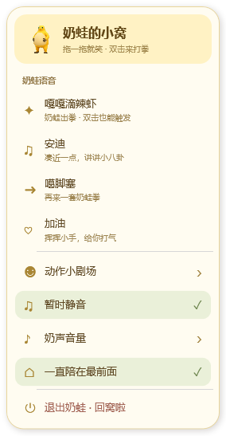
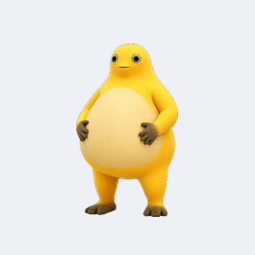
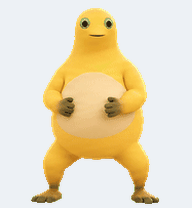
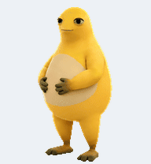

# 奶蛙桌宠

基于 C# / WPF 的 Windows 奶蛙桌宠。透明悬浮、离线运行，支持拖动捧腹大笑、双击打拳，以及“嘎嘎滴辣虾”“安迪”“噶脚塞”“加油”等语音互动。

v1.2.0 新增“奶蛙的小窝”奶油圆角菜单：奶黄高亮、浅绿选中状态、独立语音入口，以及动作和音量子菜单；托盘菜单同步使用奶油配色。





## 玩法

| 操作 | 效果 |
| --- | --- |
| 按住并拖动 | 跟随鼠标移动，循环捧腹大笑和播放笑声 |
| 松开鼠标 | 停止笑声，恢复待机，停在松手位置 |
| 单击 | 等待双击判定后笑一次，结束后恢复待机 |
| 双击 | “嘎嘎滴辣虾”＋打拳 |
| 右键菜单 | 点播四段语音动作、挥手、睡觉、静音、调节音量、置顶或退出 |
| 系统托盘 | 找回奶蛙、静音和退出 |
| 拖动时按 Esc | 取消拖动并停止播放 |

“安迪”配八卦动作，“噶脚塞”配打拳，“加油”配挥手。语音结束自动回到待机；播放语音时开始拖动，会停止台词并切换为大笑。语音不会叠播，所有声音共用静音与音量开关。

[查看带声音的四段动作演示](docs/voice-demo.mp4)

 

## 构建与运行

开发环境：Windows x64、.NET 10 SDK。应用无需网络连接，不需要管理员权限。

```powershell
git clone https://github.com/BUWANNAB/naiwa.git
cd naiwa
dotnet run --project NaiwaPet/NaiwaPet.csproj -c Release
```

构建包含 .NET 运行时的免安装单文件：

```powershell
powershell -ExecutionPolicy Bypass -File scripts/build.ps1
.\publish\NaiwaPet.exe
```

也可以直接执行：

```powershell
dotnet publish NaiwaPet/NaiwaPet.csproj -c Release -r win-x64 --self-contained true -p:PublishSingleFile=true -p:EnableCompressionInSingleFile=true -p:IncludeNativeLibrariesForSelfExtract=true -o publish
```

仅需分发生成的 `publish/NaiwaPet.exe`；运行它的电脑无需安装 .NET。仓库中不提交生成的 EXE、运行时 DLL、个人设置或下载的第三方项目源码。

## 设置与退出

默认音量 45%，启动后安静待机。窗口位置、音量、静音和置顶设置保存在当前用户 `%LOCALAPPDATA%\NaiwaPet`，嵌入的 WAV 音频也会缓存到该目录。程序不设置开机自启，同一登录会话只保留一个实例。

右键奶蛙或托盘图标选择“退出奶蛙”。退出后可以直接删除 EXE；删除 `%LOCALAPPDATA%\NaiwaPet` 可清除设置和音频缓存。

## 验证

```powershell
powershell -ExecutionPolicy Bypass -File scripts/test.ps1
powershell -ExecutionPolicy Bypass -File scripts/test.ps1 -Runtime
```

默认执行交互状态回归测试和 Release 编译。`-Runtime` 还会启动短暂的桌宠窗口，验证音频解码、播放进度、动作匹配、循环笑声、单/双击、拖动中断、静音以及自然播放结束后的鼠标状态，报告写入 `qa/runtime-checks.json`。该检查需要可用的 Windows 桌面与媒体播放环境。

本机审查构建通过 9 项交互状态测试；v1.2.0 构建通过 42 项运行检查，包含菜单语音、静音和音量操作。具体报告见 [运行验证](docs/runtime-checks.json) 和 [审查记录](docs/review.md)。这些功能检查不等同于杀毒扫描。

## 安全与素材

程序源码没有联网、下载执行外部代码、读取账号密码、全局键盘记录或开机启动逻辑。当前构建没有 Authenticode 数字签名，也没有取得杀毒引擎的成功扫描报告；不能把本仓库描述成“已认证无毒”。详见 [安全审查范围与限制](docs/security-review.md)。

角色、动画、图标与音频包含第三方素材，完整来源和固定提交见 [素材说明](ASSETS_NOTICE.md)。动作与声音在程序内配对播放，未宣称原视频逐帧口型同步，也未对第三方素材作重新授权声明。
